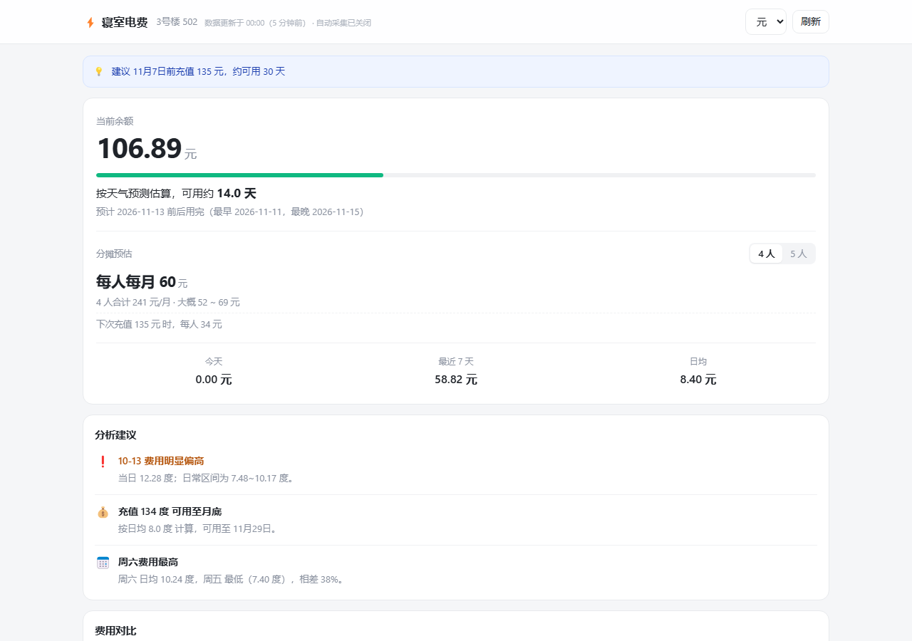
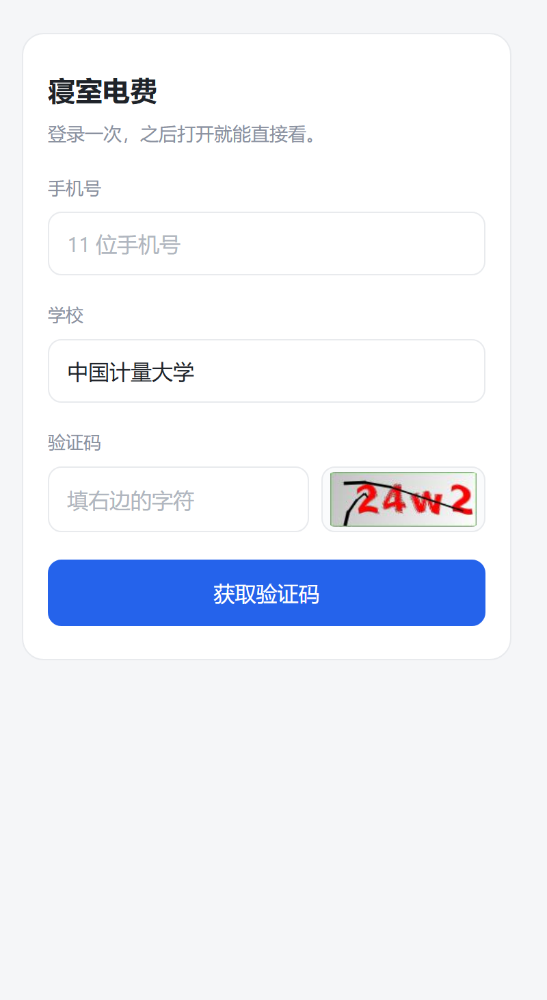

# yischool-power · 寝室电费监测

易校园 / 一卡通的寝室电费：手机验证码登录、小时级采集、本地长期存储、可视化分析。
纯 Python 标准库，ECharts 已内置，`pip install` 都不用。



## 能做什么

- **采集**：每小时一次，写进本地 SQLite。上游只保留 7 天，本地库是唯一的长历史。
- **分析**：日耗、时段画像、周规律、热力图、异常日、数据卡住识别、空置期识别。
- **预测**：加权回归 + EWMA，给出耗尽日期、乐观/悲观区间、该充多少钱。
- **提醒**：余额低 / 即将耗尽 / 消耗异常 / 数据停更 → 邮件或 webhook。
- **取数**：18 个 REST 接口 + CSV 导出；页面可加到手机主屏。

## 快速开始

```bash
python cli.py init            # 建库
python cli.py seed-demo 60    # 灌 60 天演示数据，不需要任何凭据
python cli.py serve           # http://127.0.0.1:8787
```

换成真实数据：

```bash
python cli.py login     # 终端里输手机号 + 短信验证码，不抓包
python cli.py serve     # 或者打开 /login 跟着向导走
```

## 数据源

| `source.type` | 说明 | 需要什么 |
|---|---|---|
| `nofish` | 本项目后端替你完成验证码登录（默认） | 手机号 + 短信码 |
| `demo` | 生成带真实感的演示曲线 | 无 |
| `xiaofubao` | 直接调易校园上游接口 | 抓包得到 `shiroJID` 与房间参数 |

另有网页版 `/direct`（见下），不需要改 `source.type`。

## `/direct`：多人查询

`http://<地址>:8787/direct` —— 手机号 + 学校 + 图形验证码，收短信后即可查余额。



- 每个手机号一个账号，房间和余额互相独立；
- 浏览器记住 30 天，下次打开直接查，不用反复收短信；
- 学校从内置列表里选（可输入筛选），默认中国计量大学；
- 图形验证码由人眼看图输入，不做自动识别。

命令行等价：

```bash
python cli.py direct-login --phone 138xxxxxxxx --school 10356 --open
```

## 常用命令

| 命令 | 作用 |
|---|---|
| `python cli.py init` | 初始化数据库 |
| `python cli.py login` | 终端验证码登录 |
| `python cli.py collect` | 采集一次 |
| `python cli.py loop` | 常驻整点采集 |
| `python cli.py report 30` | 终端分析报告（近 30 天） |
| `python cli.py serve` | Web 仪表盘 + API + 自动采集 |
| `python cli.py export` | 导出全部历史 CSV |
| `python cli.py check` / `quality` | 登录态自检 / 数据质量体检 |
| `python cli.py weather` / `daytype` / `model` | 气温 / 日类型 / 模型回测 |
| `python cli.py direct-login` | 直连查一次电费 |

## 接口

```
GET  /api/summary  series  daily  hourly  weekday  forecast  anomalies
     heatmap  alerts  quality  distribution  cycles  compare  insights
     export.csv  health  rooms
POST /api/collect
GET  /api/auth/status  schools
POST /api/auth/send-code  login  logout  import-curl
GET  /api/direct/schools  session
POST /api/direct/start  send-code  login  query  logout
```

都是 JSON，开了 CORS，浏览器里直接 `fetch` 即可。

## 分析口径

- **只用"可用日"**：今天没过完、上游数据卡住的那些天不计入日均，否则预测会偏得离谱。
- **充值 vs 用电**：余额跳升按充值处理；反推功率超过 3.5 kW 的跳降按抄表修正处理，都不算用电。
- **空置期**：连续多天掉到本寝室中位数的 25% 以下才判为没人住，单天偏低按异常处理。
- 数据质量评分（覆盖率 / 中断 / 卡住 / 新鲜度）会直接标在页面上，数字可不可信一目了然。

## 目录

```text
cli.py             命令行入口
ysp/               采集、分析、模型、服务端
  adapters/        数据源适配（nofish / xiaofubao / demo）
  direct_login.py  易校园 App 直连登录（签名 / AES / 登录链路）
  direct_store.py  多用户账号、令牌、房间
  direct_schools.py 学校列表
  server.py        HTTP 服务 + REST API
web/               前端页面（ECharts 本地内置）
tests/             离线测试（mock 上游，不联网）
docs/              说明与截图
tools/             小工具（图标生成）
```

## 部署

`serve` 自带采集线程，systemd 一个进程就够：

```ini
[Service]
WorkingDirectory=/opt/yischool-power
ExecStart=/usr/bin/python3 cli.py serve
Restart=always
```

公网暴露前建议：`app.host` 改回 `127.0.0.1` + Nginx 反代加认证，或限制安全组来源 IP。

## 测试

```bash
python -m unittest discover -s tests -v
```

不需要网络：上游由本地 mock 模拟，含签名、AES、整条登录链路的回归。

## 说明

- 上游接口没有公开文档，实现参考了社区项目的协议分析；易校园随时可能改版，
  版本号、UA、路径都已放进配置里。
- 请只查询本人有权查看的账户，遵守学校与易校园的使用条款。
- 仓库里不含任何真实账号、房间或电费数据；截图用的是 `seed-demo` 生成的演示数据。
